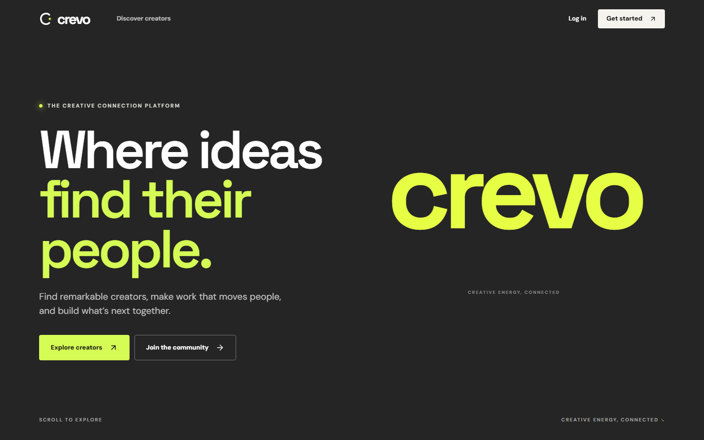

# Crevo

**Live app:** https://crevo-hackathon.onrender.com

A React and FastAPI MVP for AI creator discovery and brand collaboration. The landing page uses a live animated CREVO wordmark with layered SVG lettering and custom motion. The app includes creator profiles, AI work portfolios with tools and workflows, structured briefs, skill/tool/content-type discovery, applications, explainable matching, and project messages. Brands can close briefs, decline or accept applications, and mark projects complete.



[Hackathon demo guide](docs/demo-guide.md) · [Challenge slides](docs/challenge-deck.pptx) · [Data model note](docs/data-model.md) · [Hackathon fit and priorities](docs/hackathon-fit.md)

The public directory can include eight clearly labeled fictional demo portfolios: four AI-generated concept images and four original SVG concept illustrations. Demo feedback is never counted as a completed-project review; the demo profiles cannot sign in or apply to briefs. The no-sign-in `/demo` route lets visitors edit a sample brief, recalculate transparent rules-based matches, shortlist a creator, and preview an unsent inquiry. This walkthrough writes no account data. Create your own creator and brand accounts to try the full workflow.

The active marketplace now contains one curated creator and one brand account. Earlier records are retained in a disabled archive at the owner’s request. Public demo galleries, external creator references and sample checkout are removed; `/demo` redirects to discovery. Startup never seeds creators or demo gigs. Private account credentials are kept outside the repository.

## Run locally

Requires a supported Node.js LTS release (the container uses Node 24) and Python 3.11+.

In one terminal:

```powershell
cd backend
python -m venv .venv
.\.venv\Scripts\Activate.ps1
pip install --require-hashes -r requirements-dev.txt
Copy-Item .env.example .env
uvicorn main:app --reload
```

In a second terminal, from the project root:

```powershell
Copy-Item .env.example .env
npm install
npm run dev
```

Open `http://localhost:5173`. The API is at `http://localhost:8000`, with interactive API docs at `/docs`. Local mode creates `backend/crevo.db` and eight illustrated sample portfolios. Create one brand account and one creator account to try the full workflow.

Demo path: create a creator account → complete the profile → add an AI work sample with tools and usage terms → create a brand account → publish a structured brief → review ranked matches → return as the creator and apply → accept the application as the brand → exchange project messages → mark the project complete.

## Supabase mode

1. Create a Supabase project and run [`backend/schema.sql`](backend/schema.sql) in its SQL editor.
2. Copy `backend/.env.example` to `backend/.env` and set `SUPABASE_URL`, `SUPABASE_PUBLISHABLE_KEY`, and `SUPABASE_SECRET_KEY`. Legacy anon and service-role variable names remain supported for existing projects.
3. Restart FastAPI. `/api/health` will report `database: supabase`.
4. Add creator accounts or data in Supabase. For a hackathon walkthrough, run `python backend/seed_demo.py` from the project root to install eight clearly labeled fictional portfolios. It preserves real creator accounts and any legacy demo referenced by a project or application. Re-running it refreshes only the demo work samples. Run this again after deploying new demo art; a code deploy alone does not add rows to Supabase.
5. In Supabase Auth URL configuration, set your app URL as the site URL. If email confirmation is enabled, users must confirm their email before logging in.

The secret key stays in the backend only. All data mutations and reads go through FastAPI, which checks the user's role and ownership. The SQL enables RLS, revokes direct table access from browser roles, and explicitly grants the service role Data API access. Profile photo uploads use the public `portfolios` bucket created by the schema. Local mode has no storage substitute and displays an explicit upload error.

## Brand registration and profile

Brand registration asks for the account holder's name and a separate brand or company name. Google sign-up collects the company name before opening the provider popup. Brands can edit both names and upload a JPG, PNG, or WebP logo under 5 MB at `/brand/profile`. The company name and logo appear on the brand dashboard and on briefs that creators view. The `public.users` data model stores `company_name` (text) and `logo_url` (text); the idempotent `backend/schema.sql` adds these columns to existing Supabase projects. Logo files use a brand-specific path in the existing public `portfolios` Storage bucket. Local SQLite supports name editing; logo uploads require Supabase Storage.

## Firebase social sign-in

Crevo supports Google, Apple, and Facebook via Firebase Authentication while retaining Supabase email/password sign-in and Supabase project data. Social buttons appear only for providers listed in `FIREBASE_AUTH_PROVIDERS` after they are configured. Existing email users sign in normally and use **Connect a sign-in method** on the dashboard before using a social button. A social account with an existing Crevo email is not linked automatically.

1. Create or select a Firebase project and register a Web app. Enable Google in Firebase Authentication. In **Authentication → Settings → Authorized domains**, add `crevo-hackathon.onrender.com` (and `localhost` for local development). The Firebase CLI's Auth provider deployment does not add these domains; confirm them in the console or the live Auth project config before testing the popup.
2. In `backend/.env` locally and the Render service environment publicly, set `FIREBASE_PROJECT_ID`, `FIREBASE_API_KEY`, `FIREBASE_AUTH_DOMAIN`, and `FIREBASE_APP_ID` from the Web app config. These are public web configuration values; the Supabase secret remains server only.
3. Set `FIREBASE_AUTH_PROVIDERS=google` after Google is enabled and tested. Add `facebook` only after configuring a Meta developer app ID, app secret, and Firebase OAuth redirect URI in Meta and Firebase. Add `apple` only after configuring a Sign in with Apple service ID, team ID, key ID, and private key in Apple Developer and Firebase. Keep unconfigured providers out of the list.
4. Run the idempotent `backend/schema.sql` migration for existing Supabase projects to add `public.users.firebase_uid`. Deploy the app, then test new creator and brand sign-in and linking with real accounts.

Firebase client ID tokens are verified on the server against Google's signing certificates, issuer, audience, expiry, and provider before an app user is loaded. A new Firebase user gets a matching Supabase Auth record because Crevo's existing project tables reference `auth.users`. Firebase sign-in requires a verified email from the identity provider. Google/Facebook/Apple provider setup and end-to-end OAuth testing require the corresponding external developer accounts; the UI intentionally hides providers that are not enabled.

## Contact, reviews, and Crevo Verification

- A brand can open a creator profile and choose **Get a quote** or **Ask a question**. The request starts a private Crevo inbox thread; only that brand and creator can read or reply. The inbox refreshes messages every 10 seconds while open.
- Creators can opt in to sharing a contact email with signed-in brands by saving a **Contact email for signed-in brands** on their profile. The Email creator action opens the visitor's email app with the creator address and request details filled in. Crevo does not send, track, or store external emails.
- Brands can leave one 1–5 star review per completed Crevo project. Reviews appear publicly with the brand name and project title. Reviews cannot be posted before completion or by another account.
- A creator with at least one portfolio item can submit a public work or workflow link and a statement for verification. A profile shows **Crevo Verified** only after a configured administrator reviews and approves the request. It means submitted portfolio evidence was reviewed, not that every tool claim or outcome is guaranteed. Pending and rejected requests never show the badge.
- Set `CREVO_ADMIN_USER_IDS` in the backend or Render environment to a comma-separated list of existing account UUIDs permitted to approve requests. Hosted administrators must authenticate with a verified email; registering an email address never grants administrative access. Those accounts see **Verifications** in navigation and can review requests at `/admin/verifications`. Leave this unset to disable approvals.
- Discovery and brief creation now include 26 creative categories, including AI filmmaking, animation, 3D/CGI, generative art, product visualization, voice, copywriting, and VFX.
- All 26 categories have their own visual cards at `/categories`, linked from the glass navbar. A card opens discovery with that category selected. The demo portfolios use generated and original vector concept artwork and prominently label their fictional feedback.

The idempotent `backend/schema.sql` adds contact threads/messages, completed-project reviews, verification requests, and the creator opt-in email/approval fields. Apply it to an existing Supabase project before deploying this version. All new tables have RLS enabled and direct browser roles revoked; FastAPI enforces record ownership and uses its server-side Supabase client.

## AI behavior

Set `GEMINI_API_KEY` or `OPENAI_API_KEY` in `backend/.env` to enable real portfolio introduction generation, AI assisted structured brief drafting, and AI assisted match assessment. Gemini takes priority when both keys are present. `GEMINI_MODEL` defaults to `gemini-3.5-flash-lite`; `OPENAI_MODEL` defaults to `gpt-4.1-mini`. These features use the providers' official text generation APIs. Match ranking gives 70% weight to transparent category, skill, platform, budget, and location rules and 30% to an AI assessment of the top eight candidates. If the AI service is unavailable, the rules ranking remains available. Google says free-tier Gemini content can be used to improve its products, so avoid putting confidential client details into AI drafts on the free tier. Without an AI API key, portfolio introductions are labeled template drafts, brief drafting returns an explicit configuration error, and match ranking is labeled weighted rules. No simulated AI response is presented as AI generated.

Creators can add Instagram, Facebook, X, YouTube, and Reddit profile URLs; their public profile shows clickable platform logos for saved accounts. Creators can add work samples with a media URL, AI tools/models, production workflow, output format, and commercial-use terms. Individual tool and work claims remain **creator reported**. Crevo Verification separately records administrator review of submitted portfolio evidence. Briefs include content type, style, format/aspect ratio and commercial-use requirements. Media URLs must be publicly accessible; Supabase Storage currently handles profile photos only.

## Verify

```powershell
npm run build
npm test
cd backend
pytest -q
```

The tests cover Firebase identity verification and account linking, account creation, profile editing, AI portfolio metadata, structured briefs, discovery, applications, project messaging, contact-thread privacy, completed-project reviews, and administrator-approved verification. It uses an isolated local database.

**Validation status:** `npm run build` passes and `python -m pytest -q` passes (12 tests). The running frontend returns HTTP 200, and `/api/health` reports `database: supabase` when configured. A temporary live Supabase smoke test passed Auth login, profile updates, portfolio items, avatar Storage upload, briefs, matching, applications, messaging, and project completion; all temporary records and files were removed. Browser checks passed at desktop and mobile sizes, including navigation to discovery and signup. `npm audit --omit=dev` reports zero production dependency vulnerabilities. The hero uses lightweight CSS animation and does not require WebGL. The deployed Render service passed a temporary end-to-end test covering Supabase Auth, creator profiles, portfolio work and Gemini introduction generation, Storage upload, Gemini brief drafting, AI assessed matching, applications, project messages, and completion. Test accounts, records, and files were removed. A real-inbox signup, confirmation link, and login were verified by the project owner on 2026-10-09.

## Round 2: matching through delivery

The Round 2 layer extends the existing marketplace with portfolio-aware ranked matches and visible gaps; structured licensing comparisons; saved shortlists and audited assistant proposals; creator invitations and responses; scope/license confirmation; and versioned deliveries, revision states and a shared activity timeline. Publishing a new brief automatically proposes suitable creators for brand review. Conflicting rights block selection when structured requirements are present. The assistant uses stored platform records and the configured matching method, with transparent rules when AI is unavailable.

Uploads inspect actual PNG/JPEG/WebP/MP4 bytes for file format, aspect ratio, content type and requested duration before submission. Passed checks and file hashes stay attached to each version. Agreed rights stay attached to the project. Other deliverable types can use external links with clearly labeled manual review.

[Round 2 setup and judge walkthrough](docs/round-two-demo.md). For an isolated local demo run `python backend/run_round_two_local.py` and `npm run dev`. The launcher uses a separate local database and seeds fictional shared accounts. Apply the additive `backend/schema.sql` changes before deploying to the existing Supabase-backed service. The existing Render service publishes this repository; `/api/health` identifies this release as `round-2`.

## Current scope

- Pre-hire inbox and project conversations receive live server-sent updates while open, with a 10-second refresh fallback. Notification read status is saved on the current device.
- Creators can publish, edit, and remove public gigs with a cover image, offer details, tools, output format, and commercial-use terms. Brands can view them from creator profiles and contact the creator. Payments and orders are outside this MVP.
- A project begins when a brand accepts an application. The project workspace supports agreed scope and rights, checked file delivery, version-specific feedback, revisions, and final approval. Payments remain an explicitly labeled simulation.
- Local auth is for development. Use Supabase Auth and a strong server secret for shared deployments.
- The animated hero and logo respect reduced-motion settings and do not require WebGL.
- The lemon-green Crevo mascot from the owner's `crevo_avatar` project appears on the landing page, Categories page, and sign-in artwork. Its 3D scene is code split, pauses off-screen, respects reduced motion, and uses the supplied CSS fallback when WebGL is unavailable.


## Public deployment

The repository includes a single-service Render Docker deployment. The container builds the Vite frontend and serves it with FastAPI from one public URL. Supabase remains the persistent database, Auth service, and avatar store; Render's free container filesystem is not used for saved data.

1. Push this folder as a public GitHub repository. Local `.env` files, build output, dependencies, and the earlier `marketplace-prototype/` are excluded from Git and Docker.
2. Import `render.yaml` as a Render Blueprint. Choose the Free web service plan. Enter `SUPABASE_URL`, `SUPABASE_PUBLISHABLE_KEY`, and `SUPABASE_SECRET_KEY` as private environment values. Enter `GEMINI_API_KEY` or `OPENAI_API_KEY` to enable actual AI portfolio introductions, brief drafting, and AI match assessment. Never commit or paste these values into a public page.
3. Once Render reports the service is live, set the Supabase Auth Site URL to the public `https://...onrender.com` URL. Add `http://localhost:5173/**` as an additional redirect URL if you still use local development.
4. Check `/api/health` for `database: supabase` and `ai_enabled: true` (when the AI key is set). Complete a real creator and brand signup, confirm emails, and walk through a brief, application, acceptance, and project message.

Render's Free web service spins down after idle time, so the first visit may take about a minute. Supabase's default email service is intended for testing; configure SMTP before broad public use.

## Creator presentation

Registered member profiles appear before clearly labeled fictional demos in discovery. The landing page shows members, three sample creators with credited stock portraits, and then independent public inspiration profiles with sourced portraits. Stock models are not represented as members. Demo portraits are presentation assets only; real account identity data is unchanged. The profile-type filter separates members from demos. Photo sources and licenses are included in `public/demo-portraits/CREDITS.md`.


## Security hardening (24 October 2026)

- Local session signing has no known fallback. An unset local key uses a process-random key for private development; shared local deployments require an explicit strong key. Delivery signing uses an independent purpose-derived key, or `ASSET_SIGNING_SECRET`, and never takes a hosted delivery key from `LOCAL_JWT_SECRET`.
- Public creator and nested gig responses omit Auth owner UUIDs and contact addresses. Only signed-in brands can request an opted-in email through a rate-limited endpoint.
- Administrator access requires a server-configured account UUID and a verified hosted identity. Legacy email allowlists are ignored.
- Live shared demo accounts are banned, their passwords rotated, and sessions revoked. Interactive demos are local only and use an operator-chosen private password; `/demo` redirects to the active directory.
- Auth quotas apply per IP and account; paid AI routes share per-user and global budgets. Supabase counters are atomic and persist across restarts. Requests fail closed if quota storage is unavailable.
- Production runs as UID/GID 10001, uses digest-pinned images and hash-locked runtime dependencies, and excludes pytest, tests, and seeding scripts. Development dependencies are separately locked.

Apply the additive quota statements in `backend/schema.sql` when upgrading another installation. Regenerate locks using `uv pip compile backend/requirements.in --universal --python-version 3.11 --generate-hashes -o backend/requirements.txt` and the equivalent command for `requirements-dev.in`. Review and refresh pinned image digests with security updates. See `docs/security-hardening.md` for limits and verification.

## Curated marketplace

The creator profile presents content fit, skills and tools, portfolio evidence, declared commercial-use rights, and trust signals in an aligned responsive layout. Original Cobalt and Citrus concepts include actual generation tools, workflow notes, dimensions and provenance. The brand brief requests matching content and rights. Portfolio review remains pending; no client reviews or verification badges are invented. See `docs/curated-marketplace.json` for the content and `docs/portfolio-provenance.md` for generation records.

Archived profiles and briefs remain stored but are excluded by the application’s shared data-access layer, including direct URLs, gigs, public portfolios and matching. Disabled users cannot log in, refresh or use existing sessions. Supabase Auth also bans the retired identities; their sessions expire immediately. New public registrations remain available.
